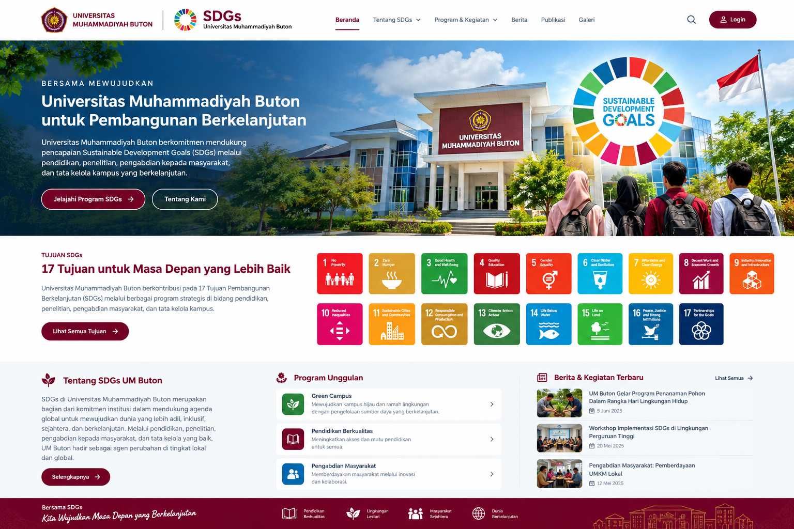

# Desain Website SDGs Universitas Muhammadiyah Buton

> Dokumen konsep UI/UX untuk portal Sustainable Development Goals (SDGs) Universitas Muhammadiyah Buton.  
> Status: rancangan awal — sesuaikan logo, foto kampus, data program, dan konten dengan aset resmi universitas sebelum publikasi.

## 1. Tujuan Website

Website menjadi pusat informasi dan dokumentasi kontribusi Universitas Muhammadiyah Buton terhadap 17 Sustainable Development Goals (SDGs), meliputi pendidikan, penelitian, pengabdian kepada masyarakat, tata kelola kampus, dan kemitraan.

**Tujuan utama**
- Menampilkan komitmen dan capaian SDGs universitas secara terukur.
- Mempublikasikan program, berita, kegiatan, laporan, dan praktik baik.
- Memudahkan sivitas akademika dan masyarakat menemukan informasi SDGs.
- Mendukung transparansi melalui indikator, data, dan dokumen yang dapat ditelusuri.

## 2. Arah Visual

### Palet warna

| Peran | Warna | Kode |
|---|---|---|
| Warna utama | Maroon | `#71001D` |
| Maroon sekunder | Merah maroon | `#8F001C` |
| Aksen | Emas | `#F8B018` |
| Latar utama | Putih | `#FFFFFF` |
| Latar bagian | Abu-abu sangat muda | `#F5F7FA` |
| Teks utama | Biru keabu-abuan gelap | `#263548` |

Gunakan warna maroon dan emas sebagai identitas universitas. Warna setiap tujuan SDGs mengikuti warna resmi masing-masing tujuan agar mudah dikenali.

### Tipografi
- **Judul:** Poppins atau Plus Jakarta Sans, bobot 600–700.
- **Isi:** Inter atau Open Sans, bobot 400–500.
- **Angka/indikator:** gunakan bobot tebal dan ukuran yang mudah dibaca.

### Gaya antarmuka
- Modern, akademik, bersih, ramah, dan berorientasi pada dampak.
- Ruang putih yang cukup, sudut kartu membulat, ikon konsisten, dan animasi ringan.
- Prioritaskan keterbacaan serta aksesibilitas, bukan dekorasi berlebihan.

## 3. Gambar Pendukung

Gunakan gambar yang relevan, autentik, dan memiliki izin penggunaan. Gambar mockup konsep yang disertakan bersama dokumen ini dapat dijadikan referensi tata letak, bukan dianggap sebagai tangkapan layar website yang sudah berjalan.

**Rencana gambar untuk halaman website**
1. **Hero/banner:** foto resmi gedung kampus atau aktivitas mahasiswa, dengan overlay gelap agar teks tetap terbaca.
2. **Pendidikan berkualitas:** dosen dan mahasiswa dalam kegiatan pembelajaran.
3. **Kampus hijau:** penanaman pohon, pengelolaan sampah, konservasi air, atau energi hemat.
4. **Pengabdian masyarakat:** kegiatan pemberdayaan masyarakat dan UMKM.
5. **Riset dan inovasi:** mahasiswa/dosen di laboratorium, ruang kerja, atau kegiatan penelitian.
6. **Kemitraan:** dokumentasi kolaborasi universitas, pemerintah, industri, dan komunitas.
7. **Berita/kegiatan:** foto dokumentasi asli dengan rasio konsisten, idealnya 16:9.

**Panduan aset gambar**
- Utamakan dokumentasi kegiatan nyata Universitas Muhammadiyah Buton.
- Siapkan gambar hero sekitar 1920 × 900 px; gambar kartu berita minimal 800 × 450 px.
- Gunakan WebP/AVIF untuk mengurangi ukuran berkas; simpan gambar asli untuk arsip.
- Tambahkan teks alternatif (`alt`) yang menjelaskan isi gambar.
- Hindari foto stok yang memberi kesan kegiatan tersebut benar-benar dilaksanakan oleh universitas jika tidak demikian.
- Pastikan izin foto, logo, dan identitas orang telah sesuai.

## 4. Struktur Navigasi

Menu utama:
- **Beranda**
- **Tentang SDGs**
  - Pengantar SDGs
  - Komitmen Universitas
  - Kebijakan dan Tata Kelola
- **17 Tujuan SDGs**
  - Halaman detail untuk setiap tujuan
- **Program & Kegiatan**
  - Pendidikan
  - Penelitian dan Inovasi
  - Pengabdian kepada Masyarakat
  - Kampus Berkelanjutan
  - Kemitraan
- **Capaian & Indikator**
  - Statistik dan indikator
  - Target tahunan
  - Laporan capaian
- **Berita**
- **Publikasi**
- **Galeri**
- **Kontak**

Jika diperlukan, sediakan tombol **Login Admin** secara terpisah dari navigasi publik.

## 5. Susunan Halaman Beranda

### A. Header
- Logo resmi universitas dan identitas “SDGs Universitas Muhammadiyah Buton”.
- Navigasi utama dengan menu dropdown yang jelas.
- Tombol pencarian.
- Header tetap di bagian atas saat halaman digulir, dengan tinggi yang tidak berlebihan.

### B. Hero utama
- Foto kampus atau aktivitas mahasiswa sebagai latar.
- Label kecil: “Bersama Mewujudkan Masa Depan Berkelanjutan”.
- Judul: **“Universitas Muhammadiyah Buton untuk Pembangunan Berkelanjutan”**.
- Deskripsi singkat tentang kontribusi melalui pendidikan, penelitian, pengabdian, dan tata kelola.
- Tombol utama: **Jelajahi Program SDGs**.
- Tombol sekunder: **Tentang SDGs**.
- Tambahkan simbol SDGs sebagai elemen visual pendukung tanpa menutupi foto atau teks.

### C. Ringkasan 17 Tujuan SDGs
- Tampilkan 17 kartu dengan nomor, ikon, dan nama tujuan.
- Setiap kartu menuju halaman detail tujuan terkait.
- Desktop: grid responsif; tablet dan ponsel: 2 kolom atau carousel yang dapat diakses.
- Sertakan tombol **Lihat Semua Tujuan**.

### D. Tentang SDGs Universitas
- Ringkasan komitmen dan pendekatan universitas.
- Foto kegiatan yang autentik.
- Tautan ke kebijakan, dokumen, dan laporan resmi.

### E. Program unggulan
Gunakan kartu program dengan ikon, ringkasan, tujuan SDGs terkait, periode, unit pelaksana, dan tautan detail. Contoh kategori:
- Kampus Hijau dan Berkelanjutan
- Pendidikan Berkualitas dan Inklusif
- Riset dan Inovasi
- Pengabdian dan Pemberdayaan Masyarakat
- Kemitraan untuk Pembangunan

Nama program, jadwal, dan capaian harus diisi berdasarkan data terverifikasi.

### F. Capaian dan indikator
- Sajikan angka utama hanya jika sumber dan periode datanya tersedia.
- Contoh indikator: jumlah kegiatan, publikasi terkait SDGs, program pengabdian, kemitraan aktif, dan kegiatan lingkungan.
- Setiap indikator mencantumkan tahun/periode, definisi, sumber data, dan tanggal pembaruan.
- Jangan menampilkan angka contoh sebagai capaian resmi.

### G. Berita dan kegiatan terbaru
- Kartu berita berisi gambar, kategori, tanggal, judul, ringkasan, dan tautan.
- Gunakan foto kegiatan asli dan metadata tanggal yang benar.
- Sediakan filter kategori dan arsip berita.

### H. Publikasi dan unduhan
- Daftar laporan SDGs, kebijakan, panduan, infografik, dan dokumen pendukung.
- Cantumkan tahun, deskripsi, format berkas, dan ukuran jika tersedia.
- Pastikan dokumen publik tidak memuat data pribadi atau informasi internal.

### I. Footer
- Logo dan alamat resmi universitas.
- Tautan cepat, kontak, kanal media sosial resmi, dan kebijakan privasi.
- Teks penutup: **“Bersama SDGs, Wujudkan Masa Depan yang Berkelanjutan.”**

## 6. Template Halaman Detail Tujuan SDGs

Setiap halaman tujuan memiliki struktur konsisten:
1. Nomor, ikon, warna, dan nama tujuan.
2. Ringkasan tujuan dalam konteks universitas.
3. Target atau indikator yang relevan.
4. Program dan kegiatan yang berkontribusi.
5. Data capaian per tahun beserta sumbernya.
6. Berita, publikasi, dan dokumentasi terkait.
7. Unit penanggung jawab atau kontak informasi.

Pastikan hubungan program dengan tujuan SDGs dijelaskan secara masuk akal dan didukung bukti, bukan sekadar menempelkan ikon SDGs.

## 7. Responsif dan Aksesibilitas

- Gunakan pendekatan **mobile-first**.
- Pastikan menu dapat digunakan dengan keyboard dan layar sentuh.
- Kontras teks dan latar harus memadai.
- Jangan mengandalkan warna saja untuk menyampaikan informasi; sertakan nomor dan label tujuan.
- Sediakan teks alternatif untuk gambar dan label yang jelas untuk tombol.
- Hormati preferensi `prefers-reduced-motion`.
- Uji tampilan pada lebar ponsel, tablet, laptop, dan monitor besar.

## 8. Rekomendasi Komponen UI

- `SiteHeader` — logo dan navigasi.
- `HeroSection` — gambar utama, judul, dan CTA.
- `SDGGoalGrid` — 17 kartu tujuan.
- `ProgramCard` — program unggulan.
- `ImpactStat` — indikator capaian.
- `NewsCard` — berita dan kegiatan.
- `PublicationList` — dokumen dan publikasi.
- `GalleryGrid` — dokumentasi kegiatan.
- `SiteFooter` — informasi kontak dan tautan.
- `SearchDialog` — pencarian konten.

## 9. Panduan Konten dan Pengelolaan

Setiap konten program idealnya memiliki:
- Judul dan deskripsi.
- Tanggal/periode pelaksanaan.
- Unit pelaksana dan penanggung jawab.
- Tujuan SDGs yang relevan.
- Lokasi dan mitra jika ada.
- Dokumentasi foto dengan izin yang sesuai.
- Indikator hasil, bukti pendukung, dan sumber data.
- Status verifikasi dan tanggal pembaruan.

Alur publikasi yang disarankan: **penulis → verifikator unit → editor/admin SDGs → publikasi**. Sediakan arsip dan riwayat pembaruan agar informasi dapat ditelusuri.

## 10. SEO, Performa, dan Keamanan

- Gunakan judul halaman dan meta description yang unik.
- Terapkan URL yang ringkas, misalnya `/sdgs/pendidikan-berkualitas`.
- Tambahkan sitemap XML, Open Graph, dan data terstruktur yang relevan.
- Kompres gambar, gunakan lazy loading untuk gambar di bawah lipatan, dan tetapkan dimensi gambar agar layout tidak bergeser.
- Terapkan HTTPS, pembaruan dependensi, validasi input, pembatasan hak akses admin, serta backup berkala.
- Sediakan kebijakan privasi dan mekanisme koreksi informasi.

## 11. Kriteria Penerimaan Desain

- Identitas visual konsisten dengan panduan resmi Universitas Muhammadiyah Buton.
- Pengunjung dapat menemukan 17 tujuan SDGs dari beranda.
- Program, berita, publikasi, dan indikator dapat ditelusuri.
- Semua gambar memiliki sumber/izin yang jelas dan teks alternatif.
- Tidak ada angka capaian, kegiatan, atau kebijakan yang ditampilkan tanpa verifikasi.
- Tampilan responsif, navigasi dapat diakses, dan waktu muat wajar.
- Konten memiliki penanggung jawab dan tanggal pembaruan.

## 12. Catatan Implementasi

Dokumen ini merupakan acuan desain awal, bukan klaim bahwa program atau capaian tertentu telah dilaksanakan. Sebelum implementasi, lengkapi dengan logo resmi, foto kampus asli, daftar program terverifikasi, kebijakan universitas, data indikator, dan kontak resmi.
